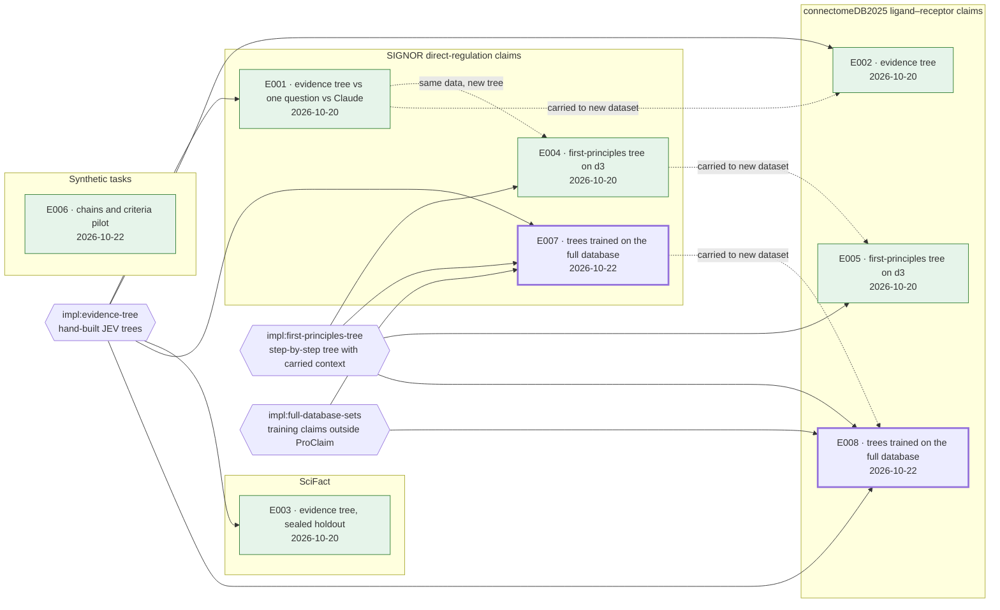

# Research map and global experiment numbering

The research map is the first section of the dashboard, placed above the experiment list. It
answers the questions the experiment list cannot: what exists, when each piece appeared, what
each experiment was built from, and how one topic's work feeds another's. Think of a
feature map in software development, applied to research: every topic, every implementation
and every experiment is a node, with its timestamp and attributes.

## One numbering system: `E###`

**Every experiment in the effort gets one global number, `E001`, `E002`, ..., from a single
counter shared by all topics.** That number is the experiment's identity everywhere: the
dashboard, its topic file, chat, commit messages, folder names, figure captions. "E007"
means one thing across the whole effort, so nobody needs to know which topic it belongs to
before they can find it.

Rules:

- **Assign at registration, not at completion.** A number is taken when the experiment is
  first written down (status `Planned`), before any design work. That way a planned
  experiment can be cited from the moment it exists.
- **Never reuse, never renumber.** An abandoned experiment keeps its number with status
  `Abandoned` and stays on the map. Gaps are fine; a renumbered experiment breaks every old
  reference to it.
- **Reserve before you build.** Re-read the dashboard, take the `Next experiment number`,
  write the registry row and bump the counter, all before any other work. Two parallel
  sessions that skip this step will both claim the same number. `scripts/check_map.py`
  flags duplicates.
- **Format.** Three digits, zero-padded (`E007`); widen to four only once you pass `E999`.
  If the project already numbers experiment folders (`experiments/007_signor_full/`), the
  folder number *is* the experiment number. Keep the folders and write `E007` in documents.
  If a folder exists, put the number first in its name (`NNN_<descriptive-slug>`).

**What earns a number.** Anything work-loop step 1 counts as a *new experiment*: a test whose
design has not yet been agreed with the user. That covers a new question, dataset, metric,
grading scheme, confound-isolating comparison, or offline re-analysis whose number the user
might act on. **What does not** earn one: arms, seeds, reruns, resumes and bug-fix restarts
of an agreed design. These live *inside* their experiment and are cited as
`E007 / gold-abstracts-in-context` plus job IDs. A follow-up that changes the design gets a
new number and a `from:` link to its parent (see Lineage below). It never gets a suffix like
`E007b`.

**Topics and implementations are named, not numbered.** Only experiments are counted, so
there is exactly one counter to keep honest. Topics and implementations get short slug IDs
for the map (`topic:signor`, `impl:evidence-tree`) and a descriptive name.

`E###` is the one bare symbol a document may use (see [naming.md](naming.md)), because the
registry defines every number in one place. On first mention in a reply, pair it with its
subject: "E004, the first-principles SIGNOR tree".

## What the map section contains

Three parts, in this order, under `## Research map` (full skeleton in
[../templates/dashboard.md](../templates/dashboard.md)):

1. **Counter line.** `Next experiment number: **E009**` and the date the map was last updated.
2. **Map diagram** (`### Map`): the structure at a glance.
3. **Registry** (`### Registry`): one row per node, with timestamps and attributes. The
   diagram is drawn *from* this table, and the table wins whenever the two disagree.

### Division of labour with the experiment list

The registry records **identity and provenance**: what an experiment is, when it appeared, what
it was built from, and what it runs on. The experiment list (`## Experiments`, directly below
the map) records **progress**: the question, its status, its effort and its one-line result.
No fact is kept in both. The one exception is status, which also appears as a style class on
the map node so the diagram can be read without the list. `check_map.py` verifies that the
two copies agree.

## The registry

```markdown
### Registry

| ID | Kind | Name | Topic | Created | Updated | Attributes | Links |
|---|---|---|---|---|---|---|---|
| topic:signor | topic | SIGNOR direct-regulation claims | — | 2026-10-20 | 2026-10-22 | data: ProClaim-eval SIGNOR (101 claims), signor_full (400) | [topic file](signor.md) |
| impl:evidence-tree | implementation | Hand-built JEV evidence trees (v-series) | — | 2026-10-20 | 2026-10-22 | code: experiments/001_*/trees.py; current best v6 | [README](experiments/001_signor_evidence_tree/README.md) |
| E007 | experiment | Trees trained on claims from the full SIGNOR database | topic:signor | 2026-10-22 | 2026-10-22 | data: signor_full 400 claims, 5-fold CV · model: JEV typesafe/jev-1.14 · uses: impl:evidence-tree, impl:first-principles-tree · from: E001, E004 · jobs: — | [E007](signor.md#e007) |
```

- **Kind** is `topic`, `implementation` or `experiment`.
- **Topic** is filled for experiments only. An experiment that spans topics lists its main
  topic here and the rest under `also:` in Attributes.
- **Created** is the registration date. **Updated** is the date of the last change to the
  node's facts: a new arm, a new result, a status change. Use absolute dates (`YYYY-MM-DD`),
  never "yesterday".
- **Attributes** are `key: value` pairs separated by ` · `. Use these keys where they apply,
  in this order, and add others only when a reader would filter on them:
  `data` (dataset and split, with n), `model` (backbone or backend), `uses` (implementation
  IDs), `from` (parent experiment IDs), `jobs` (approved job IDs only, see
  [background-jobs.md](background-jobs.md)), `cost`, `owner` (only when work streams are
  split between people).
- **Links**: the experiment's stable anchor in its topic file (`topic.md#e007`), the code
  folder, or the implementation's source file.

## The diagram

**Default: Mermaid `flowchart LR`.** It renders in GitHub, GitLab, Obsidian and VS Code, it
lives as text inside the dashboard, and it diffs cleanly.

````markdown
### Map


````

(This is JevMaster's real experiment set; the statuses are illustrative.)

Conventions:

- **One `subgraph` per topic**, holding that topic's experiments. Implementations sit outside
  every subgraph, because they are shared, and use the hexagon shape `{{ }}`.
- **Experiment node label:** `E### · <descriptive name, at most ~8 words><br/><created date>`.
  The node ID is the bare number (`E007`), so edges read naturally.
- **Edges:** a solid `impl --> E` means "this experiment uses that implementation". A dotted,
  labelled `E -. "relation" .-> E` means lineage: what changed from the parent, in two to five
  words. Draw lineage only where a later experiment reuses an earlier one's data, code, frozen
  model or design. Do not draw it for experiments that merely came later.
- **Status as a class** (`planned`, `running`, `done`, `abandoned`), matching the first
  word of the experiment list's Status column. `Designing` (being grilled) uses `planned`.
- **Tangle control.** Solid `uses` edges cross topics and tangle quickly. With more than
  about three implementations, first group them in one `subgraph impls["Implementations"]`.
  If the diagram is still hard to follow, drop the `uses` edges from the diagram. The
  registry's `uses:` attribute already records them, and the dotted lineage edges carry more
  information.
- **Size.** Past about 25 experiments, collapse finished topics to a single summary node
  (`topic_scifact_done["SciFact · E003, E011–E014 · all done"]`) and keep full detail only for
  topics with open work. The registry still lists every experiment.

**Other formats** (only if the user asks):

- **ASCII tree**, for users who read the dashboard in a terminal or for tools that don't
  render Mermaid. Put it in a ```` ```text ```` block with the same content: topics as
  branches, experiments as leaves, `uses:` and `from:` written inline on each leaf.
- **Excalidraw**, for a presentation or a meeting, drawn with the `excalidraw-diagram`
  skill. Save it beside the dashboard and link to it from the Map section. It is an export of
  the registry, never the source of truth. Regenerate it from the registry rather than editing
  it by hand.

## When to update the map

Update the map in the same edit that changes the underlying fact, never later:

| Event | Registry | Diagram | Counter |
|---|---|---|---|
| New topic | add `topic:` row | add subgraph | — |
| New implementation, or one is substantially rewritten | add or update `impl:` row | add node or edges | — |
| Experiment registered | add `E###` row (Created = today) | add node with `planned` class, plus `uses`/`from` edges | bump |
| Design agreed, run started, finished, abandoned | bump Updated | change class | — |
| New arm or rerun inside an experiment | bump Updated; add approved job IDs | — | — |
| Experiment moved to another topic | change Topic | move node between subgraphs | — |

Run `python3 <skill-dir>/scripts/check_map.py <path/to/DASHBOARD.md>` after any edit to the
map or the experiment list. It reports duplicate or missing numbers, a counter at or below an
existing number, experiments present in one part but missing from another, status mismatches
between the map and the list, and topic-file headings that name an unregistered number.

## Migrating an existing dashboard

Older dashboards from this skill number questions per area (`Baseline transfer Q3`), so `Q1`
recurs across areas. **Propose the migration and wait for the user's agreement before doing
it.** It changes every reference the user has learned. Once it is agreed:

1. Order the existing questions by creation date (from git history or the dates in their
   sections). If no dates are recoverable, use the dashboard's current row order. Assign
   `E001...` in that order. If the project already has global experiment numbers (as
   JevMaster's folders do), keep them and number only what they don't cover.
2. In each topic file, change the heading to `## E### — <question>`, add the stable anchor
   `<a id="e###"></a>` above it, and record the old label once:
   `(formerly Baseline transfer Q3)`. Leave an anchor for the old slug as well, so existing
   links keep working.
3. Rebuild the experiment list keyed by `E###`, then build the registry and the diagram.
   Run `check_map.py`.
4. Note the migration and its date in Cross-cutting notes.
